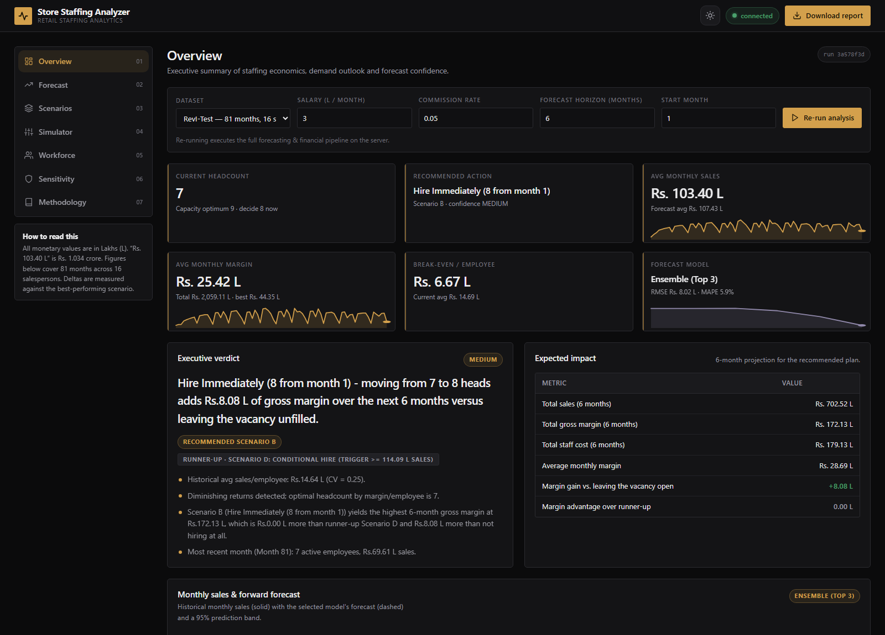
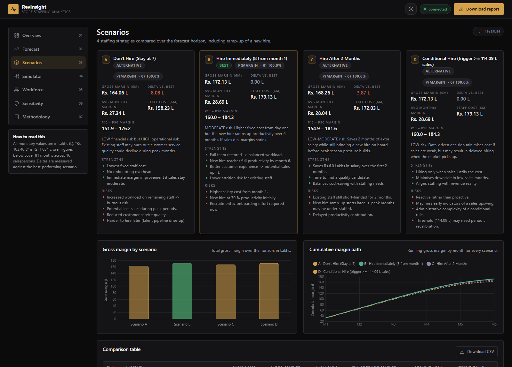
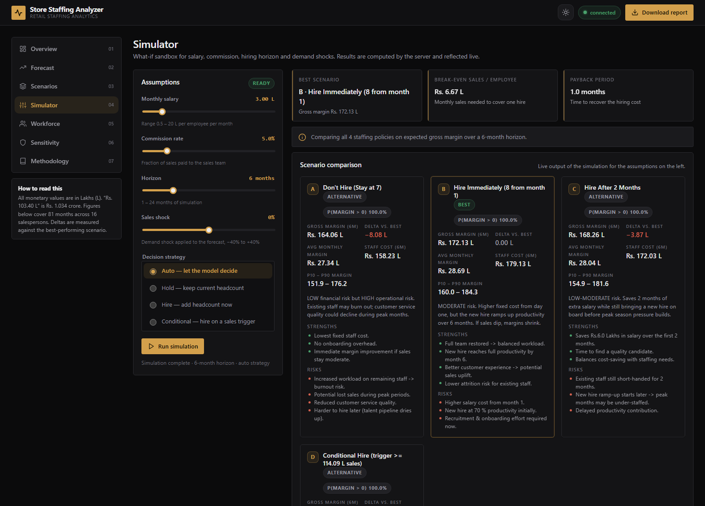
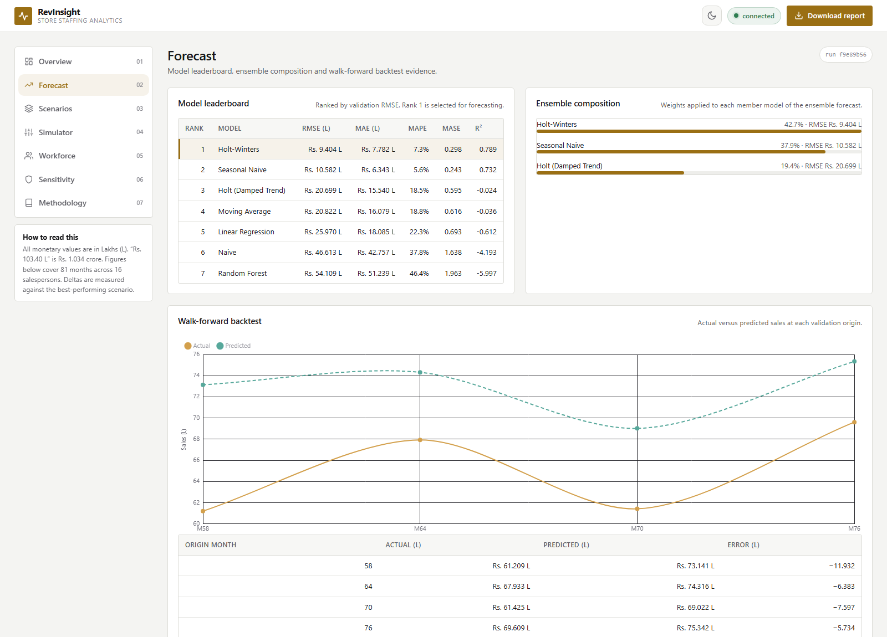
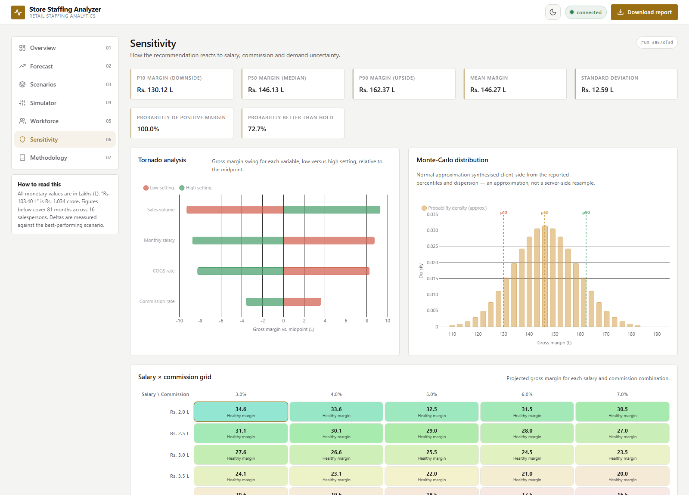
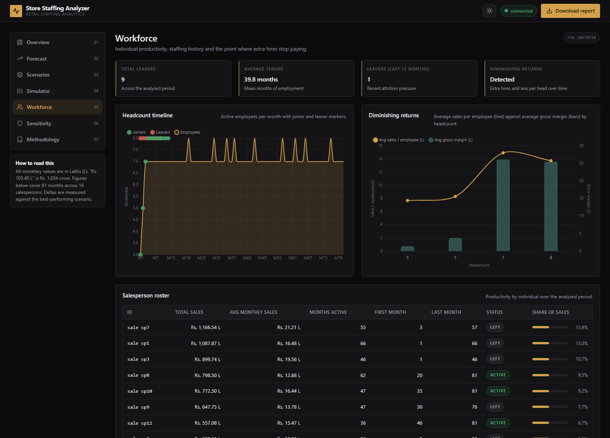

# Store Staffing Analyzer — Retail Staffing Analytics

**A production-grade decision engine for retail staffing.**
Forecast demand, price every staffing policy, and quantify the risk before you
make the hire.

[](https://www.python.org/)
[](https://fastapi.tiangolo.com/)
[](LICENSE)
[](tests/)

> **Live demo** → [https://store-staffing.onrender.com](https://store-staffing.onrender.com) &nbsp;·&nbsp;
> **API docs** → [https://store-staffing.onrender.com/api/docs](https://store-staffing.onrender.com/api/docs) &nbsp;·&nbsp;
> **Report** → `reports/Recommendation_Report.pdf`

---

## Table of contents

- [The problem](#the-problem)
- [What Store Staffing Analyzer does](#what-store-staffing-analyzer-does)
- [Key results](#key-results)
- [Screenshots](#screenshots)
- [Live demo](#-live-demo)
- [Quick start](#quick-start)
- [Architecture](#architecture)
- [Methodology](#methodology)
- [Project structure](#project-structure)
- [REST API](#rest-api)
- [Configuration](#configuration)
- [Testing](#testing)
- [Deployment](#deployment)
- [Roadmap](#roadmap)
- [License](#license)

---

## The problem

A branded-clothing store in a Bangalore mall has **81 months** of history and
**16 salespeople**. One senior salesperson has resigned. The store is now
short-handed, and the owner has to answer four questions:

1. Should we **replace** the departing employee, and if so, **when**?
2. How much **revenue** will we actually lose if we leave the seat empty?
3. How **certain** can we be — what if sales, salary or commission move?
4. Is there a **smarter rule** than "always replace the leaver"?

Most answers stop at "we hired someone, margin went up". This project answers
all four with a defensible statistical model, a live dashboard, and a
board-ready report.

---

## What Store Staffing Analyzer does

| Capability | Detail |
|---|---|
| **Forecasting** | 7-model zoo (Naive, Seasonal Naive, Moving Average, Holt-Winters, damped Holt, trend regression, lag-aware Random Forest) selected by **walk-forward cross-validation**, blended into an inverse-RMSE **ensemble**, with **bootstrap prediction intervals**. |
| **Controlled productivity** | The marginal value of one more employee is estimated by a **first-difference OLS** that differences out the store's secular growth and controls for the calendar season. |
| **Seasonality** | STL decomposition, calendar-month seasonal indices, seasonality strength, and **automatic cycle-length detection** (the data turns out to be semi-annual, not annual). |
| **Anomaly detection** | Robust (MAD-based) z-scores on the deseasonalised residual, plus structural-break detection. |
| **Workforce analytics** | Per-salesperson tenure, ramp-up, share of sales, and a full joiner/leaver timeline. |
| **Financial modelling** | Gross margin, break-even, contribution margin, vacancy cost, payback period, ROI. |
| **Scenario engine** | Four staffing policies (hold / hire now / hire in 2 months / conditional) priced with an explicit new-hire ramp-up curve, plus **probabilistic P10/P50/P90 bands**. |
| **Risk quantification** | Tornado sensitivity across salary, commission, COGS and demand, plus a **Monte-Carlo** simulation of the margin distribution. |
| **Policy backtest** | The adaptive staffing rule is replayed over history and compared against "always replace" — savings are *measured*, not asserted. |
| **Delivery** | CLI, REST API, responsive web dashboard, and PDF/HTML reports — all from one pipeline. |

---

## Key results

Running the shipped dataset through the pipeline:

| Metric | Value |
|---|---|
| Months analysed | 81 (16 salespersons, 0 missing values) |
| Average monthly sales | Rs. 103.40 L |
| Average monthly gross margin | Rs. 25.42 L |
| Break-even sales per employee | Rs. 6.67 L |
| **Controlled marginal sales per employee** | **Rs. 11.25 L** (first-difference OLS, R² = 0.89) |
| Net margin contributed by a marginal hire | Rs. 2.06 L / month (vs. Rs. 3.0 L salary) |
| Selected forecast model | **Ensemble (Top 3)** — Holt-Winters 43 %, Seasonal Naive 38 %, Holt 19 % |
| Walk-forward validation | RMSE **8.02 L**, MAPE **5.95 %**, R² **0.846** |
| Detected seasonal cycle | **6 months** (semi-annual trough in Mar & Sep) |
| Seasonality strength | 0.86 |
| Anomalous months | 1 |
| Historical leavers | 9 |
| **Recommendation** | **Hire Immediately (8 from month 1)** — MEDIUM confidence |
| Margin gain vs. leaving the vacancy empty | **Rs. 8.08 L over 6 months** |
| Payback period | 1.0 month · ROI 44.9 % |
| Adaptive rule vs. "always replace" | +Rs. 3.00 L, avoiding overstaffing in 21 % of months |

> **Why the numbers moved from v1.** Version 1 credited a new hire with the
> *average* sales per employee. That overstates the case, because the extra
> employee is the marginal one. Version 2 estimates the marginal effect
> properly and still recommends hiring — but for defensible reasons.

---

## Screenshots

**Overview** — executive verdict, KPI strip and the expected-impact table:



**Scenarios** — four staffing policies priced side by side with probabilistic bands:



**Simulator** — live what-if sandbox for salary, commission, horizon and demand shocks:



**Forecast** — model leaderboard, ensemble weights and walk-forward backtest:



**Sensitivity** — tornado analysis, Monte-Carlo distribution and the salary × commission grid:



**Workforce** — tenure, attrition and the headcount timeline:



---

## 🚀 Live demo

| Resource | URL |
|---|---|
| **Live Dashboard** | [store-staffing.onrender.com](https://store-staffing.onrender.com) |
| **API docs (Swagger)** | [store-staffing.onrender.com/api/docs](https://store-staffing.onrender.com/api/docs) |
| **OpenAPI schema** | [store-staffing.onrender.com/api/openapi.json](https://store-staffing.onrender.com/api/openapi.json) |

**Deploy in five minutes (Render):**

```bash
git push                                   # push to your GitHub repo
# In Render: New -> Blueprint -> point at this repo -> Apply
```

Render picks up `render.yaml` automatically: it installs `requirements.txt`,
runs `uvicorn store_staffing.api.main:app`, and health-checks `/api/v1/health`.
See [Deployment](#deployment) for the Docker, Fly.io and local-Docker paths.

---

## Quick start

### Requirements

Python 3.10+ (developed and tested on 3.13).

### 1. Install

```bash
git clone https://github.com/bishwamanDas/retail-staffing-optimizer.git
cd retail-staffing-optimizer

python -m venv .venv
source .venv/bin/activate        # Windows: .venv\Scripts\activate

pip install -r requirements.txt
```

### 2. Run the analysis

```bash
python run.py data/RevI-Test.csv
```

```
[SUMMARY] RECOMMENDATION
  Current staff count : 7
  Recommended action  : Hire Immediately (8 from month 1)
  Confidence          : MEDIUM
  Avg monthly sales   : Rs.103.40 L
  Avg monthly margin  : Rs.25.42 L
  Forecast model      : Ensemble (Top 3)
  Payback period      : 1.0 months
```

Useful flags:

```bash
python run.py data/RevI-Test.csv --salary 3.5 --commission 0.06
python run.py data/RevI-Test.csv --forecast-months 12
python run.py data/RevI-Test.csv --output-dir my_run --json
python run.py data/RevI-Test.csv --no-charts        # numbers only, fast
```

### 3. Launch the dashboard

```bash
python run.py serve --port 8000
# or
uvicorn store_staffing.api.main:app --reload --port 8000
```

Open <http://127.0.0.1:8000> — the dashboard and the API share one origin.

---

## Architecture

```
┌──────────────────────────────────────────────────────────────────┐
│                        Presentation                              │
│   web/ (vanilla JS + Chart.js)   │   CLI   │   PDF / HTML report │
└───────────────┬──────────────────┴─────────┴──────────┬──────────┘
                │  /api/v1 (FastAPI)                    │  store_staffing.cli
┌───────────────▼──────────────────────────────────────▼──────────┐
│                        Orchestration                            │
│              store_staffing/pipeline.py  →  one payload             │
│              (identical numbers for every surface)              │
└───────────────┬──────────────────────────────────────────────────┘
                │
┌───────────────▼──────────────────────────────────────────────────┐
│                          Domain                                  │
│  forecasting    financial_analysis   staffing_model              │
│  seasonality    anomaly               people                     │
│  sensitivity    recommendation        visualization              │
│  config         utils                                            │
└──────────────────────────────────────────────────────────────────┘
```

**Design principles**

- **One engine, many surfaces.** The CLI, the REST API and the PDF report all
  consume the *same* payload, so a number can never disagree between them.
- **Graceful degradation.** Every optional stage (seasonality, anomalies,
  workforce, reports) is wrapped so that a failure degrades the output
  instead of crashing the pipeline.
- **No hidden state.** Business assumptions live in a single validated
  `AnalysisConfig`; the CLI, API and environment can all override them.
- **Honest uncertainty.** Every recommendation ships with a confidence level,
  the drivers behind it, and the probability of being wrong.

### Data flow

```
CSV ──► load_and_validate_data ──► prepare_monthly_summary
                                        │
     ┌──────────────────┬───────────────┼──────────────┬──────────────────┐
     ▼                  ▼               ▼              ▼                  ▼
  forecast         financial       staffing       seasonality        people
 (zoo + CV)       (margins)      (scenarios)     (STL + cycle)    (tenure/attrition)
     └──────────────────┴───────────────┼──────────────┴──────────────────┘
                                        ▼
                     sensitivity (tornado + Monte-Carlo)
                                        ▼
                              AnalysisResult payload
                     ┌──────────────────┼──────────────────┐
                     ▼                  ▼                  ▼
                REST API            charts            PDF / HTML
```

---

## Methodology

### 1. Forecasting — walk-forward validation, not a single split

A single train/test split answers "how did this model do on *those* 12
months?". The engine instead evaluates every candidate on **rolling origins**
that end at the last observation, forecasting the **real deployment horizon**
(6 months) at each origin:

```
origin 57 ─► train on months 1-57  ─► forecast 58-63 ─► compare to actual
origin 63 ─► train on months 1-63  ─► forecast 64-69 ─► compare to actual
origin 69 ─► train on months 1-69  ─► forecast 70-75 ─► compare to actual
origin 75 ─► train on months 1-75  ─► forecast 76-81 ─► compare to actual
```

Pooled out-of-sample errors across all origins rank the models. The top three
are blended with inverse-RMSE weights and the ensemble is scored on the
*blended* folds — the number reported is the ensemble's real error, not an
average of its members'.

**Prediction intervals** come from a 2,000-draw residual bootstrap, so they
widen realistically with the horizon instead of assuming homoscedasticity.

### 2. Marginal productivity — differencing out the growth

Comparing "months with 7 staff" against "months with 8 staff" is invalid: the
store grew for 81 months, and the 8-staff months are not a random sample.
The engine regresses **month-on-month changes**:

```
ΔSales ~ trend + month-of-year effects + ΔHeadcount
```

Differencing removes the secular growth entirely. The coefficient —
**Rs. 11.25 L of sales per additional employee** — is the controlled marginal
effect, and it is what drives every scenario calculation.

### 3. Seasonality — detecting the cycle that is actually there

An annual model cannot absorb a semi-annual pattern. The engine measures the
autocorrelation of the detrended series at lags 3, 4, 6 and 12 and selects the
**shortest dominant period** — 6 months for this dataset, revealing March and
September troughs that a 12-month decomposition would have mislabelled as
"anomalies".

### 4. Scenarios — a ramp curve, not a step change

A new hire is not productive on day one. The scenario engine applies a
ramp-up curve (70 % → 100 % over six months) to the marginal contribution and
prices four policies over the horizon, then adds a probabilistic band derived
from the forecast interval.

### 5. Risk — how wrong could we be?

- **Tornado**: each assumption swung independently to show what actually moves
  the margin.
- **Monte-Carlo**: 5,000 paths sampling demand (calibrated to the prediction
  interval), salary (±5 %) and commission (±0.5 pp) to give P10/P50/P90 and the
  probability of a positive margin.
- **Policy backtest**: the adaptive rule is replayed across the full history
  against "always replace", so the claimed saving is measured rather than
  assumed.

---

## Project structure

```
Store Staffing Analyzer/
├── store_staffing/                     # the importable package
│   ├── __init__.py                 # version + lazy exports
│   ├── config.py                   # AnalysisConfig: all business assumptions
│   ├── utils.py                    # loading, validation, aggregation
│   ├── forecasting.py              # model zoo, walk-forward CV, ensemble, intervals
│   ├── financial_analysis.py       # margins, break-even, sensitivity, payback, ROI
│   ├── staffing_model.py           # productivity, marginal effect, scenarios, optimiser
│   ├── seasonality.py              # STL decomposition, seasonal indices
│   ├── anomaly.py                  # robust anomaly + structural-break detection
│   ├── people.py                   # tenure, ramp-up, attrition, headcount timeline
│   ├── sensitivity.py              # tornado + Monte-Carlo + decision stability
│   ├── recommendation.py           # board-ready narrative generation
│   ├── visualization.py            # 20+ publication-quality charts
│   ├── report_generator.py         # PDF (fpdf2) + HTML reports
│   ├── pipeline.py                 # orchestration → one JSON payload
│   ├── cli.py                      # `run` / `serve` commands
│   └── api/
│       ├── main.py                 # FastAPI application
│       └── services.py             # run registry, dataset discovery, cache
├── web/                            # responsive dashboard (no build step)
│   ├── index.html
│   └── assets/{css,js}/
├── data/                           # RevI-Test.csv, RevI-Test-Large.csv
├── docs/
│   ├── api_contract.md             # the published API contract
│   └── screenshots/                # dashboard images used above
├── tests/                          # 203 tests
├── run.py                          # CLI entry point
├── pyproject.toml / requirements.txt
├── Dockerfile / docker-compose.yml / render.yaml / fly.toml / Procfile
├── Makefile
└── .github/workflows/ci.yml        # tests + lint + docker build
```

---

## REST API

Base URL `/api/v1` · full schema in [`docs/api_contract.md`](docs/api_contract.md).

| Method | Endpoint | Purpose |
|---|---|---|
| `GET` | `/api/v1/health` | Liveness + uptime + cached-run count |
| `GET` | `/api/v1/datasets` | Bundled datasets with row/month metadata |
| `POST` | `/api/v1/analyses` | Run the pipeline (dataset id **or** CSV upload) |
| `GET` | `/api/v1/analyses` | List cached runs |
| `GET` | `/api/v1/analyses/{run_id}` | Full result payload |
| `DELETE` | `/api/v1/analyses/{run_id}` | Delete a run and its artefacts |
| `POST` | `/api/v1/analyses/{run_id}/report` | Render the report artefacts (PDF/HTML/CSV/charts) |
| `GET` | `/api/v1/analyses/{run_id}/charts/{name}.png` | Generated chart |
| `GET` | `/api/v1/analyses/{run_id}/report.pdf` | PDF report |
| `GET` | `/api/v1/analyses/{run_id}/report.html` | HTML report |
| `GET` | `/api/v1/analyses/{run_id}/results.csv` | Monthly results export |
| `POST` | `/api/v1/simulate` | What-if simulator (salary / commission / horizon / demand shock) |
| `GET` | `/api/v1/analyses/{run_id}/sensitivity` | Tornado, Monte-Carlo and grid |

> **Fast by default.** `POST /analyses` returns the numbers in ~6 s. The
> charts and the PDF/HTML report are rendered **on demand** by
> `POST /analyses/{id}/report` (the dashboard calls it when you click
> *Download report*) and are then cached on disk, so the second download
> is instant. The `GET` artefact routes render them automatically if they
> are missing.

**Example**

```bash
curl -X POST http://127.0.0.1:8000/api/v1/analyses \
  -F dataset=RevI-Test \
  -F salary=3.0 -F commission=0.05 -F forecast_months=6
```

```bash
curl -X POST http://127.0.0.1:8000/api/v1/simulate \
  -H "Content-Type: application/json" \
  -d '{"run_id":"<id>","salary":4.0,"commission":0.06,"horizon":12}'
```

Interactive documentation lives at `/api/docs`.

---

## Configuration

Every assumption is a single validated object (`store_staffing/config.py`) and can
be overridden from the CLI, the API or the environment.

| Setting | Default | CLI | Environment |
|---|---|---|---|
| Monthly salary per employee | Rs. 3.0 L | `--salary` | `SSA_SALARY` |
| Commission rate | 5 % | `--commission` | `SSA_COMMISSION` |
| Cost of goods sold | 50 % | — | `SSA_COGS` |
| Forecast horizon | 6 months | `--forecast-months` | `SSA_FORECAST_MONTHS` |
| Random seed | 42 | — | `SSA_SEED` |
| First dataset month is January | Jan | `--start-month` | — |

See `.env.example` for the full list.

### Design system

The dashboard uses a deliberately restrained, editorial palette rather than a
gradient-and-glow "AI" look: neutral graphite surfaces, a single brass accent,
hairline borders instead of shadows, small radii, and tabular numerals
throughout. A light theme ships alongside it, and the dashboard is verified
for zero console errors and zero horizontal overflow at 390 / 820 / 1280 /
1600 px in both themes.

---

## Testing

```bash
pip install -r requirements-dev.txt
pytest                       # 203 tests
pytest --cov=store_staffing --cov-report=term-missing
```

The suite covers the data contract, every model's edge cases, the financial
algebra, the staffing engine, the seasonality/anomaly/workforce modules, the
end-to-end pipeline (including the large 120-month dataset), API-contract
conformance, and every HTTP endpoint via `TestClient`.

CI runs the suite on Python 3.10/3.11/3.12, lints with Ruff and Black, and
builds the Docker image on every push.

---

## Deployment

| Target | Command |
|---|---|
| **Render** | Push to GitHub → *New → Blueprint* (uses `render.yaml`) |
| **Fly.io** | `fly launch && fly deploy` (uses `fly.toml`) |
| **Docker** | `docker compose up --build` |
| **Any PaaS** | `pip install -r requirements.txt && uvicorn store_staffing.api.main:app --host 0.0.0.0 --port $PORT` |

The container runs as a non-root user, ships a `python`-based health check
(no `curl` dependency), and is configured for headless chart generation.

---

## Roadmap

- [x] Controlled marginal-productivity model
- [x] Walk-forward validation, ensembling, prediction intervals
- [x] Seasonality, anomaly and workforce analytics
- [x] Monte-Carlo risk quantification and policy backtesting
- [x] FastAPI service + responsive dashboard + PDF/HTML reports
- [x] 203-test suite, CI, Docker, multi-cloud deployment
- [ ] Postgres-backed run history (swap the in-memory registry)
- [ ] Authenticated multi-tenant API
- [ ] Bayesian hierarchical demand model with store-level partial pooling
- [ ] Shift-level (intra-day) staffing optimisation

---

## License

MIT — see [LICENSE](LICENSE).

---

<div align="center">

**Built with** FastAPI · pandas · NumPy · scikit-learn · statsmodels · SciPy ·
Matplotlib · seaborn · fpdf2 · Chart.js · pytest · Docker

*Authored by Bishwaman Das*

</div>
